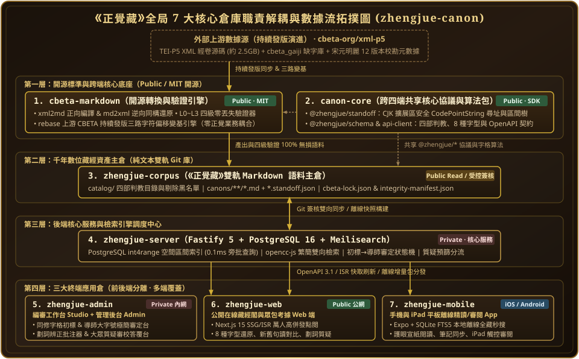
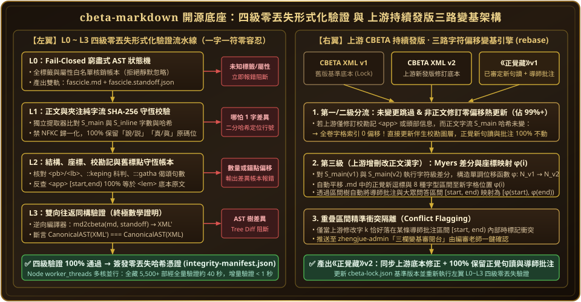
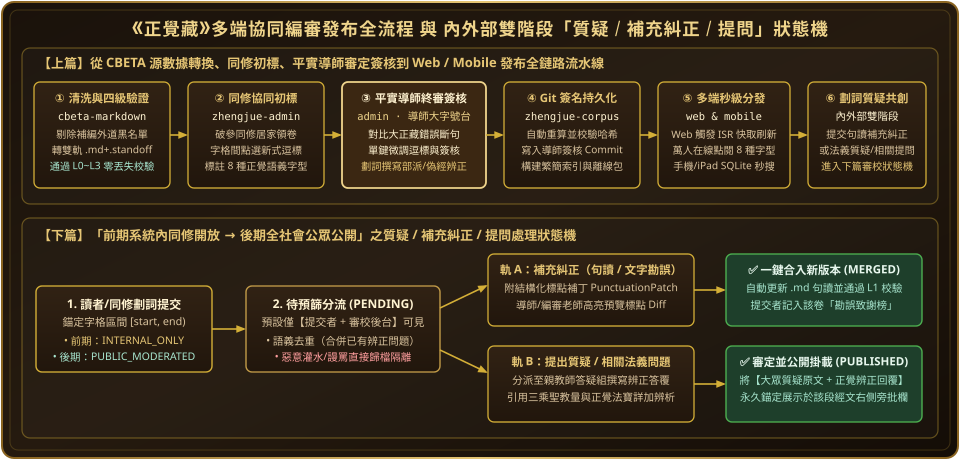

# 《正覺藏》數位藏經工程 (Zhengjue Canon)

**正本清源 · 重新句讀審定 · 辨正偽經偽論 · 奠定正法久住千年基業**

---

## 一、 緣起與核心使命

本組織（`zhengjue-canon`）致力於構建 <b>《正覺藏》（《正覺大藏經》）</b> 全流程數位化編審、重新句讀、多字型排版、電腦注解式劃詞辨正與跨平台（Web / 桌面審定端 / iOS & Android 移動端）高併發閱讀共創體系：

1. **正本清源、重編藏經目錄**：
   - 依佛滅後第一次七葉窟內五百阿羅漢結集與七葉窟外千人大眾部大乘結集之正統標準，重構 <b>「正法藏部 · 正覺法寶部 · 部派論典辨正部 · 偽佛法部」</b> 四維典籍體系；
   - 徹底剔除 2016 年版 CBETA《大藏經補編》所混入之宗喀巴《廣論》等喇嘛教外道著作及近代六識論邪說；
   - 對《大正藏》原密教部偽經（如《大日經》《金剛頂經》《大乘莊嚴寶王經》等）歸入 <b>偽佛法部</b>，一對一掛載辨正專文並標註「剪貼簿式」法位錯置段落；
   - 為遭歐美日學術界誣指為「疑偽」之真實大乘經論（如《楞嚴經》《大乘起信論》《占察善惡業報經》等）審定平反。
2. **分散式初標與導師逐卷句讀審定**：
   - 糾正《大正藏》與既有電子佛典因不明八識論真義而導致之斷句錯謬（如《成唯識論述記》等），由破參同修透過網路協同初標現代標點逗標，最終由 <b>平實導師親自逐卷審定簽核</b>。
3. **正覺多字型語義排版還原**：
   - 完整收錄 平實導師與正覺同修會全部講經講義、《成唯識論釋》與專書，嚴格還原正覺書籍特有之 <b>8 種語義字型體系</b>（區分 `經文`、`頌文`、`論文`、`問句`、`判教提示`、`白話語譯`、`導師釋文`、`編案`）。
4. **「類電腦檔案注解功能」之不改原文劃詞辨正**：
   - 針對部派佛教凡夫僧論典（如《大毘婆沙論》、安慧《大乘廣五蘊論》等），鎖定底本原文一字不改，採用 <b>分離式偏移錨定（Standoff Annotation）</b> 技術挑選論文段落，旁批注解其文意、錯誤落處與法義過失。
5. **內外部雙階段「提出質疑 / 補充糾正 / 相關問題」與多端離線/在線閱讀**：
   - 前期面向系統內同修協同勘誤，後期向社會公眾開放；支援針對任意經文區間、句讀或批注提交結構化句讀糾錯（`PunctuationPatch`）、法義質疑與修學提問；經審校與親教師撰寫辨正答覆後，將具代表性之 <b>「大眾質疑 + 正覺辨正回覆」</b> 公開掛載於經文旁。

---

## 二、 全局多倉庫職責解耦架構（7 大核心倉庫矩陣）

按照 <b>「開源公益與內部業務解耦、前後端與多端演進週期解耦、公網閱讀與高權限後台安全物理隔離」</b> 原則，本組織採用 <b>7 大核心倉庫 + 共享協議底座</b> 之架構設計：

  

### 組織核心倉庫導航與邊界劃分

| 序號 | 倉庫名稱 | 開源策略 | 核心職責與包含模組 | 核心技術棧 |
| :---: | :--- | :---: | :--- | :--- |
| **1** | 🔧 **`cbeta-markdown`** | **Public (MIT)** | **CBETA TEI-P5 XML ⇄ 雙軌無損 Markdown 雙向編譯與驗證引擎**：含 `xml2md` 正向編譯器、`md2xml` 逆向還原器、`verifier` 四級零丟失形式化驗證器、`rebase` 上游發版三路變基工具（零正覺業務耦合，面向全球佛學與數位人文社區開源）。 | `TypeScript` · `Node 22` · `fast-xml-parser` · `unified/remark` · `worker_threads` |
| **2** | 🧬 **`canon-core`** | **Public** | **跨四端共享核心協議與算法 SDK**（`@zhengjue/schema`、`@zhengjue/standoff`、`@zhengjue/api-client`）：封裝 CJK 擴展區生僻字安全之 `CodePointString` 字格尋址器與區間樹（Interval Tree）算法，確保後端、Web、管理端、移動端字偏移計算 100% 同構。 | `Pure TypeScript` · `Zod` · `openapi-typescript` |
| **3** | 📜 **[`zhengjue-corpus`](https://github.com/zhengjue-canon/zhengjue-corpus)** | **Public** (受控寫入) | **《正覺藏》千年數位資產語料主倉**：獨立存放四部判教目錄（`catalog/`）、雙軌制經卷（`.md` + `.standoff.json`）、上游版本鎖（`cbeta-lock.json`）及全藏零丟失驗證帳本（`integrity-manifest.json`）。 | `ZJ-Markdown` · `Standoff JSON` · `YAML Catalog` · `Git Signed Commits` |
| **4** | ⚙️ **`zhengjue-server`** | **Private** | **後端核心 API 服務與檢索引擎調度中心**：提供經卷與伴生圖層高併發查詢、同修初標 → 導師審定簽核狀態機、大眾質疑/糾錯工單預篩分流、上游變基任務調度及 Git 雙向自動同步。 | `Fastify 5` · `PostgreSQL 16 (GiST int4range)` · `Drizzle ORM` · `Meilisearch` · `opencc-js` |
| **5** | 🖥️ **`zhengjue-admin`** | **Private** (高權限) | **編審工作台與後台管理端（Studio + Admin 二合一）**： • **審定工作台**：同修字格點選初標台、平實導師大字號極簡審定台、部派/偽經劃詞辨正批注器、CBETA 上游升級衝突三欄審閱台； • **教務管理後台**：大眾質疑/補充糾正審校與親教師答覆台、四部目錄編排與 RBAC 權限審計。 | `React 19` · `Vite 6` · `TanStack Router & Query` · `Tailwind CSS v4` · `shadcn/ui` |
| **6** | 🌐 **`zhengjue-web`** | **Public** | **公開在線藏經閣閱讀與眾包考據 Web 端**：面向全球讀者的高併發點閱門戶（SSG/ISR + CDN 邊緣快取）、正覺 8 種語義字型排版、新舊句讀一鍵對照、電腦式旁批軌道、劃詞發起「質疑 / 補充糾正 / 提問」。 | `Next.js 15 (App Router)` · `React 19` · `Tailwind CSS v4` · `Typst PDF 導出` |
| **7** | 📱 **`zhengjue-mobile`** | **Private** (上架商店) | **跨平台移動端與平板端原生 App（iOS / Android / iPadOS）**：內置離線藏經閣引擎（支援整部/全藏離線下載與本地毫秒級繁簡全文檢索）、護眼宣紙精讀、書籤筆記雲同步，以及 <b>iPad 平板導師/親教師大字號觸控審閱模式</b>。 | `React Native (Expo 52+)` · `op-sqlite (SQLite FTS5)` · `@shopify/flash-list` |
| **0** | 🏛️ **[`.github`](https://github.com/zhengjue-canon/.github)** | **Public** | 組織主頁配置、全局架構設計藍圖與公共視覺資產庫。 | `GitHub Profile` · `Pure Vector SVG Architecture` |

---

## 三、 `cbeta-markdown` 開源底座：零信息丟失驗證與上游持續發版變基設計

現有開源 CBETA 轉 Markdown 工具普遍存在「靜默丟失 `<lg><l>` 偈頌、丟失雙行夾注、丟失宋元明麗校勘記與行號座標」之嚴重缺陷。`cbeta-markdown` 透過 <b>雙軌無損分流</b>、<b>四級形式化驗證</b> 與 <b>三路字符偏移變基</b> 徹底攻克上述難題：

  

1. **L0 窮盡式 Fail-Closed 狀態機（未知節點零容忍）**：拒絕白名單抽取模式；凡 XML 中出現之任何標籤、屬性或文本節點均須顯式核銷，遇到任何未定義標籤立即報錯終止，絕不靜默丟棄。
2. **L1 正文與夾注純字符流 SHA-256 守恆 + 二分哈希定位**：獨立提取器直接從原 XML 提取主幹純漢字序列 `S_main` 與雙行夾注序列 `S_inline`（<b>嚴禁執行會破壞古籍異體字的 NFKC 歸一化</b>，100% 保留 `說/説`、`真/眞` 原碼位），與 `.md` 提取結果比對字數與 `SHA-256`；一旦有 1 字差異，透過 <b>二分前綴哈希搜尋</b> 在 `< 1ms` 內精準定位至具體第 `k` 字與 `<pb>/<lb>` 行號。
3. **L2 結構、座標、校勘記與舊標點守恆帳本**：逐項核對 `<pb>/<lb>` 里程碑、`::keping` 科判樹、`:::gatha` 偈頌句數；並以 `.standoff.json` 中每條 `<app>` 的字格區間 `[start, end)` 反查 `.md` 純字流，斷言截取出的文字 <b>100% 等於原 XML `<lem>` 底本文字</b>；同時驗證將 `legacyPunctuation` 插回純字流後與原 XML 帶標點正文完全相等。
4. **L3 雙向往返同構驗證（`XML ⇄ MD+Standoff`）**：內置逆向編譯器 `md2cbeta`，將 `.md + .standoff.json` 逆向還原為 TEI-P5 XML AST 並與原 XML AST 進行規範化同構比對，從信息論上給出 <b>100% 無損轉換</b> 之終極證明。
5. **上游 CBETA 持續發版三路字符偏移變基（`cbeta2md rebase`）**：當上游 `cbeta-org/xml-p5` 發版時，未變更或僅修訂校勘記/頭信息之經卷（佔 99%+）字格座標 0 偏移，直接熱更新伴生圖層；當上游增刪改正文漢字時，透過字符級 Myers 差分構造單調位移映射 `φ(i)`，自動平移 `.md` 中的正覺新逗標與 `.standoff.json` 中的導師批注區間 `[φ(start), φ(end))`，僅在批注覆蓋字被修改時推送至 `zhengjue-admin` 三欄審閱台人工確認。

---

## 四、 多端協同全流程與雙階段「質疑 / 補充糾正 / 提問」狀態機設計

  

---

  <b>正覺同修會 · 《正覺藏》數位工程委員會</b> | 以八識正理審定句讀，令正法久住千年

