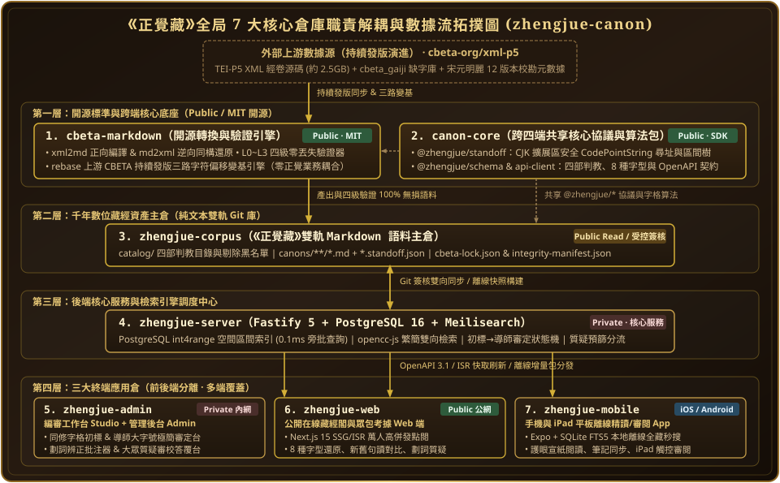

# 《正覺藏》數位藏經工程 · 內部研發與編審門戶 (v3.0)

**正本清源 · 重新句讀審定 · 全量改動溯源 · AI 驅動工程**

---

## 組織內部 8 大私有倉庫快速入口

1. 📚 **[`zhengjue-docs`](https://github.com/zhengjue-canon/zhengjue-docs)** —— 全局文檔、Wiki、歷年會員大會考證報告、AI 可執行需求規格（`REQ-01..06`）與全局排期（`ROADMAP.md` / `TODO.md`）
2. 🔧 **[`cbeta-markdown`](https://github.com/zhengjue-canon/cbeta-markdown)** —— CBETA XML ⇄ 原始基準快照與雙軌 Markdown 編譯器、L0～L3 四級零丟失驗證、上游三路變基與 `.docx` 差分導入器
3. 🧬 **[`canon-core`](https://github.com/zhengjue-canon/canon-core)** —— 跨四端共享協議與 `ChangeLedger` 確定性狀態重放內核
4. 📜 **[`zhengjue-corpus`](https://github.com/zhengjue-canon/zhengjue-corpus)** —— 《正覺藏》五位一體語料主倉（`*.cbeta.json` + `*.changes.jsonl` + `articles/*.md` + `*.md` + `*.standoff.json`）
5. ⚙️ **[`zhengjue-server`](https://github.com/zhengjue-canon/zhengjue-server)** —— Fastify 5 + PostgreSQL 16 (`int4range`) + Meilisearch 後端核心服務
6. 🖥️ **[`zhengjue-admin`](https://github.com/zhengjue-canon/zhengjue-admin)** —— 同修初標台、平實導師大字號審定台、評審直接撰文與「我的評審」中心、`.docx` 導入核對與管理後台
7. 🌐 **[`zhengjue-web`](https://github.com/zhengjue-canon/zhengjue-web)** —— Next.js 15 高併發在線藏經閣與全透明改動溯源閱讀端
8. 📱 **[`zhengjue-mobile`](https://github.com/zhengjue-canon/zhengjue-mobile)** —— Expo (iOS / Android / iPad) 離線藏經閣與平板觸控審閱端
